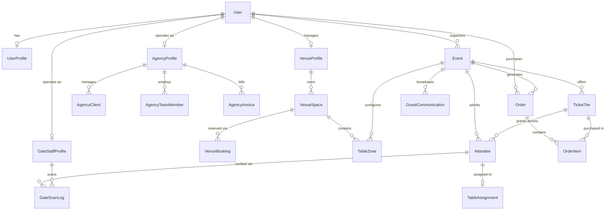

# Innosight Backend Architecture & Data Models

Production-grade database models and architecture for the Multi-Role Event Management Platform (**Innosight / McEniesVite**).

---

## 1. Domain Overview

The schema is divided into 9 cohesive domain modules designed for high scalability and clear separation of concerns:



---

## 2. Modules Summary

### 1. Identity & Multi-Role (`User`, `UserProfile`)
- Roles: `SUPER_ADMIN`, `ORGANIZER_INDIVIDUAL`, `ORGANIZER_AGENCY`, `ORGANIZER_VENUE`, `GATE_STAFF`, `GUEST`
- Supports password hash, verified email/phone, and preferences.

### 2. Agency & Enterprise Operations (`AgencyProfile`, `AgencyClient`, `AgencyTeamMember`, `AgencyInvoice`)
- Multi-client retainer management
- Team crew assignments and roles
- B2B invoice generation with payment tracking.

### 3. Venue & Space Operations (`VenueProfile`, `VenueSpace`, `VenueBooking`, `TableZone`, `TableAssignment`)
- Physical spaces/halls with hourly and daily rental tariffs
- Banquet table zones (`ROUND`, `RECTANGLE`, `SQUARE`) and individual attendee seat assignments
- Booking conflict resolution and security deposits.

### 4. Events & Sessions (`Event`, `EventScheduleSession`, `PromoCode`)
- Multi-day, hybrid, in-person and virtual streaming configurations
- Structured session schedule and speaker tracks
- Promotional discount codes with usage limits.

### 5. Ticketing & Orders (`TicketTier`, `Order`, `OrderItem`, `Payout`)
- Tiered ticketing (`FREE`, `EARLY_BIRD`, `GENERAL`, `VIP`, `SPEAKER`, `SPONSOR`)
- High-concurrency inventory caps
- Multi-gateway checkout (`PAYSTACK`, `STRIPE`, `FLUTTERWAVE`)
- Automatic platform commission split and organizer bank payouts.

### 6. Fast Gate Check-In (`Attendee`, `GateStaffProfile`, `GateStaffShift`, `GateScanLog`)
- Cryptographic unique QR code hash per ticket
- Turnstile gate scanning logs with duplicate detection
- Sub-second verification responses.

### 7. Communications & Broadcasts (`GuestCommunication`)
- Broadcast campaigns over Email, SMS, WhatsApp, and Push
- Audience segmentation (`all`, `vip`, `unchecked_in`)
- Delivery, open rate, and click rate analytics.

### 8. Governance & Auditing (`PlatformAuditLog`, `PlatformSetting`, `NotificationMessage`)
- Immutable event logs for financial actions and logins
- Dynamic platform take-rate and transaction ceilings.

---

## 3. Enterprise NestJS Interactive Swagger Documentation

Once the NestJS server is started, visit:
👉 **`http://localhost:5001/api/docs`**

The interactive OpenAPI 3.0 Swagger UI features:
- **Authentication**: `POST /api/auth/register`, `POST /api/auth/login`, `GET /api/auth/me`
- **Events**: `GET /api/events`, `POST /api/events`, `GET /api/events/{id}`, `POST /api/events/{id}/publish`
- **Tickets & Pricing**: `GET /api/tickets/{eventId}`, `POST /api/tickets/{eventId}`
- **Orders & Inventory**: `POST /api/orders/checkout` (Generates cryptographic QR passes)
- **Turnstile Gate Scanning**: `POST /api/gate/verify` (Instant admission and duplicate check-in detection)
- **Agency Operations**: `GET /api/agency/clients`, `POST /api/agency/clients`, `GET /api/agency/invoices`
- **Venue & Space Leasing**: `GET /api/venue/spaces`, `POST /api/venue/spaces`, `GET /api/venue/bookings`, `GET /api/venue/tables`
- **Platform Super Admin**: `GET /api/admin/metrics` (Matches Figma Platform Dashboard telemetry: 142 Organizers, 847 Events, ₦4.2M Revenue)

---

## 4. Quickstart Guide (NestJS)

```bash
cd D:\Ramjan\frontend\omolaraeniolaos\omolaraeniolaos-backend

# 1. Install dependencies
npm install

# 2. Push Prisma Schema to your Render PostgreSQL database
npx prisma db push

# 3. Generate the Prisma Client
npx prisma generate

# 4. Start NestJS Development Server with Swagger UI
npm run start:dev
```
