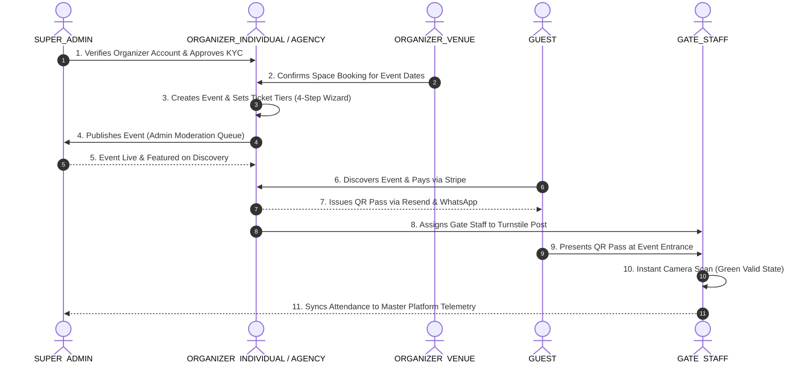

# McEniesVite Event OS — Complete Multi-Role Functionality Specification

> **Source Reference**: Figma Design System & Architecture  
> **Figma File**: `omolaraeniolaos || McEniesVite || #FO6311B33F7C8` (Node ID: `636-19287` / Canvas: Admin Panel, Individual, Agency, Venue, Gate Staff, Guest)  
> **Backend Enum**: `UserRole` in Prisma Schema

---

## Executive Role Matrix Overview

```prisma
enum UserRole {
  SUPER_ADMIN
  ORGANIZER_INDIVIDUAL
  ORGANIZER_AGENCY
  ORGANIZER_VENUE
  GATE_STAFF
  GUEST
}
```

| Role Enum | Target Persona | Primary Device / Surface | Primary Value Proposition |
| :--- | :--- | :--- | :--- |
| **`SUPER_ADMIN`** | Platform Owners & Operations | Desktop Admin Console | Complete ecosystem telemetry, user verification, KYC, event moderation, commission, and global payouts. |
| **`ORGANIZER_INDIVIDUAL`** | Independent Creators & Event Hosts | Desktop & Tablet Organizer OS | 4-step event creation wizard, ticket pricing, direct guest invites, revenue wallet, and team delegation. |
| **`ORGANIZER_AGENCY`** | Event Management & Production Companies | Desktop Agency Studio | Multi-client retainer accounts, B2B billing/invoicing, corporate event production, and crew permissions. |
| **`ORGANIZER_VENUE`** | Convention Centers, Halls & Hotel Venues | Desktop Facility Manager | Space leasing, calendar bookings, table layout & banquet seat assignment, and compound security. |
| **`GATE_STAFF`** | On-site Entry Officers & Turnstile Staff | Mobile PWA / Handheld Scanner | High-speed camera QR scanning, multi-gate shift tracking, manual lookup, and offline attendance sync. |
| **`GUEST`** | Event Attendees & Consumers | Mobile & Responsive Web | Event discovery, multi-tier ticket purchasing via Stripe, pass wallet, WhatsApp/Email alerts, and gate entry. |

---

## 1. Role: `SUPER_ADMIN` (Platform Governance)

### Overview
The centralized command center for McEniesVite platform operators to oversee all organizers, events, transactions, and platform health. Designed on Figma Canvas `Admin Panel` (`636:19287`).

### Core Features & Functionalities

#### 1.1. Ecosystem Telemetry & Executive Analytics
- **Live Platform Metrics**: Real-time KPI cards matching the Figma design:
  - Total Registered Organizers (Individual, Agency, Venue breakdown)
  - Active & Completed Events count
  - Total Gross Merchandise Value (GMV)
  - Platform Commission Revenue (net platform take-rate)
  - Active Gate Check-in velocity across all running events
- **Interactive Revenue Charts**: Monthly and quarterly volume trends with currency toggle (USD, NGN, GBP).

#### 1.2. Global Event Oversight & Moderation
- **Event Audit & Approvals**: View all published and draft events across the platform.
- **Content Moderation**: Flag, suspend, or take down events violating platform guidelines or terms of service.
- **Featured / Trending Management**: Promote high-profile events to the public discovery landing page.
- **Event Cancellation & Emergency Overrides**: Administrative trigger for mass event cancellation with automatic Stripe refund handling.

#### 1.3. User & Identity Governance
- **Global User Directory**: Filterable database of all users across all 6 roles.
- **KYC & Verification Approvals**: Review and approve submitted government IDs, CAC/business registration certificates for agencies and venues.
- **Account Status Management**:
  - `ACTIVE`: Fully verified and authorized.
  - `PENDING_VERIFICATION`: Awaiting administrative document review.
  - `SUSPENDED`: Temporarily restricted from publishing events or withdrawing funds.
  - `DEACTIVATED`: Permanently terminated accounts.

#### 1.4. Financial Ledger & Payout Disbursements
- **Commission Rate Controls**: Configure default platform take-rate percentage and fixed per-ticket processing fees.
- **Payout Disbursement Approval Queue**: Review and release pending payout requests submitted by organizers.
- **Stripe Connect & Bank Transfer Ledger**: Direct audit trail of all money in (ticket sales) and money out (organizer payouts).
- **Chargeback & Dispute Management**: Monitor disputed transactions, hold escrow funds, and log resolution status.

#### 1.5. Platform Audit Logs & Security
- **Tamper-Evident Audit Trail**: Every sensitive action (role change, payout release, event deletion) is logged with Actor UUID, Role, IP Address, Timestamp, and Metadata.
- **System Configuration**: Manage platform-wide constants, SMTP/Resend API configurations, and Stripe live keys.

---

## 2. Role: `ORGANIZER_INDIVIDUAL` (Independent Creator OS)

### Overview
The dedicated operating system for independent hosts, party planners, creators, and single-brand event organizers. Designed on Figma Canvas `Organizer/Individual` (`75:711`).

### Core Features & Functionalities

#### 2.1. 4-Step Event Creation Wizard
1. **Step 1: Basic Info & Atmosphere**:
   - Event Title, Slug, Category (Music, Tech, Gala, Conference, Networking).
   - Event Format: `IN_PERSON`, `VIRTUAL`, or `HYBRID` (with stream link).
   - Physical Location: Venue Name, Address, City, Country, Google Maps integration.
   - Date & Time: Start date/time, end date/time, and timezone selector.
   - Privacy Settings: Public discovery vs. Private (unlisted/passcode-protected).
   - Media Assets: Event banner/poster upload, promo video URLs.
2. **Step 2: Ticket Tiers & Capacity Quotas**:
   - Multi-tier ticket creation: `FREE`, `EARLY_BIRD`, `GENERAL`, `VIP`, `SPEAKER`, `SPONSOR`.
   - Tier Pricing: Price per ticket, quantity cap, max purchase limit per order.
   - Sales Windows: Scheduled release date and automatic cut-off timer.
   - Perks & Inclusions: Bulleted perk items (e.g., "Free Cocktail", "Front Row Seat", "Backstage Pass").
3. **Step 3: Direct Invitations & VIP Passports**:
   - Single & Bulk Invitee intake via CSV / Email list.
   - Custom RSVP email templates with personal temporary passcodes.
   - Dual Registration Paths: Special VIP QR link vs. Public standard checkout link.
4. **Step 4: Live Telemetry & Tracking Setup**:
   - Tracking pixel setup (Meta Pixel, Google Analytics).
   - Target RSVP conversion goals and automated inventory alert thresholds.

#### 2.2. Attendee Management & Pass Directory
- **Attendee Roster**: Live searchable list of all registered guests with ticket tier, payment status, and check-in status (`ATTENDING`, `CHECKED_IN`, `NO_SHOW`).
- **Pass Re-issuance**: Resend ticket confirmation and QR code passes via Resend email with one click.
- **Manual Guest Check-in**: Desktop fallback tool to check in guests manually by name, email, or order number.

#### 2.3. Guest Communications Workspace
- **Multi-Channel Broadcasts**: Compose and send announcements via **Email** (Resend), **SMS**, and **WhatsApp**.
- **Audience Segmentation**: Target broadcasts to:
  - All registered guests
  - VIP ticket holders only
  - Unchecked-in guests (e.g., "Doors open in 1 hour!")
  - Checked-in guests (e.g., "Welcome! WiFi password is...")
- **Campaign Analytics**: Track delivery rate, open rate, and click rate.

#### 2.4. Revenue Wallet & Payouts
- **Gross Sales Dashboard**: Real-time sales total, platform fee deductions, and net withdrawable balance.
- **Payout Requests**: Request direct withdrawals to linked bank accounts.
- **Financial History Ledger**: Granular transaction-by-transaction log of all ticket sales, refunds, and processed withdrawals.

#### 2.5. Sub-Role Team Delegation
- **Invite Collaborators**: Invite trusted team members with limited portal access:
  - **Vendors**: Stall & product showcase access.
  - **Artists / Performers**: Stage schedule, soundcheck times, and backstage credentials.
  - **Event Staff**: General field coordination.

---

## 3. Role: `ORGANIZER_AGENCY` (Multi-Client Production Agency)

### Overview
A B2B enterprise workspace for event management agencies, PR firms, and production companies managing multiple corporate brands, concurrent events, and cross-functional production crews. Designed on Figma Canvas `Organizer/Agency` (`588:7501`).

### Core Features & Functionalities

#### 3.1. Corporate Client Roster Management
- **Client Directory**: Manage corporate retainer accounts (e.g., "Acme Corp", "Techstars", "Red Bull").
- **Client Profiles**: Industry, primary contact person, billing email, corporate tax ID, and active contract value.
- **Client Portfolio**: Filter events, budgets, and invoices specifically by corporate client.

#### 3.2. Multi-Event Agency Operations
- **Concurrent Production Calendar**: Cross-client master schedule showing overlapping load-ins, show dates, and post-production wrap days.
- **Client-Branded Event Sites**: Publish white-labeled events with client brand guidelines, custom logos, and custom color accents.
- **Client Access Portals**: Give corporate client representatives view-only access to their specific event telemetry and attendee counts without exposing other clients.

#### 3.3. Production Crew & Permissions Matrix
- **Agency Team Member Directory**: Assign specialized agency roles:
  - **Executive Producer**: Full financial and operational permissions.
  - **Stage Director / Production Lead**: Runs schedule, artist cues, and agendas.
  - **Guest Logistics Coordinator**: Manages VIP invitations, seating, and check-in staff.
- **Granular Permissions Matrix**: JSON-based permission flags ensuring team members only access events and tabs they are assigned to.

#### 3.4. B2B Invoicing & Retainer Billing
- **Agency Invoice Generator**: Create formal corporate invoices for event production retainers, technical equipment, and talent fees.
- **Invoice Tracking**: Statuses: `DRAFT`, `PENDING`, `SENT`, `PAID`, `OVERDUE`, `CANCELLED`.
- **Commission Split Calculator**: Calculate agency commission fees (e.g., 15% standard commission) against event production spend.

---

## 4. Role: `ORGANIZER_VENUE` (Facility & Space Manager)

### Overview
A specialized portal for hotels, convention centers, clubs, banquet halls, and outdoor event spaces managing physical properties, rentable halls, layout designs, and calendar bookings. Designed on Figma Canvas `Organizer/Venue` (`705:14928`).

### Core Features & Functionalities

#### 4.1. Physical Space & Facility Catalog
- **Space Management**: Register multiple distinct spaces within a compound:
  - **Space Types**: `BALLROOM`, `AUDITORIUM`, `TERRACE`, `BOARDROOM`, `EXHIBITION_HALL`, `BANQUET_HALL`, `ROOFTOP`.
  - **Physical Specs**: Maximum guest capacity, square meters, ceiling height, stage dimensions.
  - **Pricing Model**: Configurable hourly rental rate, daily full-buyout rate, and required security deposit.
  - **Facility Amenities**: Multi-tag selection (Audio/Visual System, Projectors, Green Room, Loading Dock, AC, Catering Prep Kitchen).

#### 4.2. Venue Booking Calendar & Lease Requests
- **Interactive Space Calendar**: Real-time availability schedule with color-coded booking statuses:
  - `AVAILABLE`: Open for leasing.
  - `BOOKED`: Confirmed lease with organizer.
  - `MAINTENANCE`: Closed for renovations or repairs.
- **Lease Reservations & Contracts**: Intake booking requests from external organizers, negotiate dates, and issue booking confirmations with unique booking codes.

#### 4.3. Floor Plan & Table Zone Designer
- **Table Zone Layouts**: Configure room floor arrangements matching the event format:
  - **Table Shapes**: `ROUND` (Banquet), `RECTANGLE` (Conference), `SQUARE`.
  - **Capacity Math**: Number of tables, seats per table, and total zone capacity.
- **VIP & Seat Assignment Engine**: Map confirmed event attendees directly to specific Table Numbers and Seat Numbers.

#### 4.4. Compound Security & Incident Control
- **Security Hotline & Gate Protocol**: Manage security checkpoint rules for the facility.
- **Maximum Compound Capacity Alarms**: Real-time tracking of total foot traffic across all concurrent spaces to prevent fire safety code violations.

---

## 5. Role: `GATE_STAFF` (High-Speed Gate OS)

### Overview
A mobile-first, high-concurrency Progressive Web App (PWA) designed for turnstile operators, bouncers, and gate officers scanning tickets at high volume. Designed on Figma Canvas `Gate Staff` (`570:9939`).

### Core Features & Functionalities

#### 5.1. Shift & Gate Assignment Onboarding
- **Shift Invitation Acceptance**: Enter shift via quick SMS / Email invite link without complicated passwords.
- **Turnstile / Gate Identifier**: Staff selects their designated post (e.g., `Gate A-1`, `VIP Turnstile`, `Main Entrance 2`).
- **Shift Duration**: Active session logging with shift start/end timestamps.

#### 5.2. Instant Camera QR Barcode Scanner
- **Zero-Latency Video Stream Scanning**: Utilizes native device camera with continuous barcode detection.
- **Instant Audio / Visual Feedback States**:
  - **🟩 GREEN (VALID PASS)**:
    - Plays high-pitch confirmation chime + haptic vibration.
    - Displays: Attendee Full Name, Ticket Tier (`VIP` / `General`), and Assigned Seat/Table.
  - **🟨 YELLOW (DUPLICATE / ALREADY USED)**:
    - Warning vibration + alert sound.
    - Displays: *"Already Scanned at Gate A-2 at 18:42 by Staff #104"*.
  - **🟥 RED (INVALID / UNPAID / CANCELLED)**:
    - Error buzzer + haptic warning.
    - Displays: *"Invalid Pass or Ticket Cancelled / Refunded"*.

#### 5.3. Manual Lookup & Guest Verification
- **Search Fallback**: Search by attendee name, email, or order reference for guests whose phone screens are cracked or batteries died.
- **Manual Check-In Override**: One-click check-in with staff identifier logged for accountability.

#### 5.4. Offline Resilience & Sync Session
- **Offline Cache**: Pre-downloads the encrypted event attendee manifest to local device IndexedDB before the event begins.
- **Offline Scanning**: If venue cellular reception drops or Wi-Fi fails, gate scanning continues with zero interruption.
- **Auto-Sync Floating Sessions**: When network connectivity is restored, all cached scans with precise timestamps automatically synchronize via `/api/gate/sync-batch`.

#### 5.5. Gate Shift Telemetry
- **Personal Gate Counter**: Shows staff member's live tally: *"You have scanned 342 guests this shift"*.
- **Event Velocity Counter**: Live percentage of total expected guests checked in.

---

## 6. Role: `GUEST` (Consumer Discovery & Attendance Lifecycle)

### Overview
The public consumer and attendee journey across responsive web and mobile interfaces. Designed on Figma Canvas `Guest` (`20:9`).

### Core Features & Functionalities

#### 6.1. Event Discovery & Public Landing
- **Search & Filter Directory**: Filter events by category, date range (Today, This Weekend, This Month), location, and price (Free vs. Paid).
- **Rich Event Details Page**:
  - Hero poster & video trailer.
  - Performer lineup, speakers, and schedule sessions.
  - Venue location with interactive maps.
  - Organizer verified badge and social links.

#### 6.2. Frictionless Multi-Tier Checkout
- **Tier Selection**: Choose ticket quantity with real-time remaining inventory alerts (e.g., *"Only 4 VIP tickets left"*).
- **Promo Code Discounts**: Apply validated promotional coupon codes for instant percentage or fixed discounts.
- **Stripe Payments Integration**:
  - Credit/Debit Card payments.
  - One-tap checkout via Apple Pay & Google Pay.
  - 100% free RSVP tickets process instantly without payment forms.

#### 6.3. Digital Ticket Passport & Wallet
- **Cryptographic QR Code Pass**: Instantly generated high-contrast QR code optimized for phone screens.
- **Multi-Channel Pass Delivery**:
  - Immediate on-screen confirmation with downloadable PDF badge.
  - High-deliverability HTML email receipt dispatched via **Resend**.
  - Optional WhatsApp pass delivery with QR image.
  - Integration with Apple Wallet and Google Wallet.

#### 6.4. Attendee Self-Service & Profile
- **My Tickets Dashboard**: Access all past and upcoming event tickets in one place.
- **RSVP Status Updates**: Confirm attendance or mark status as tentative.
- **Account Settings**: Manage contact details, dietary preferences, accessibility requirements, and email notification toggles.
- **Post-Event Experience**: Submit event ratings, reviews, and receive notifications when favorite organizers publish new events.

---

## Summary: End-to-End Cross-Role Workflow


